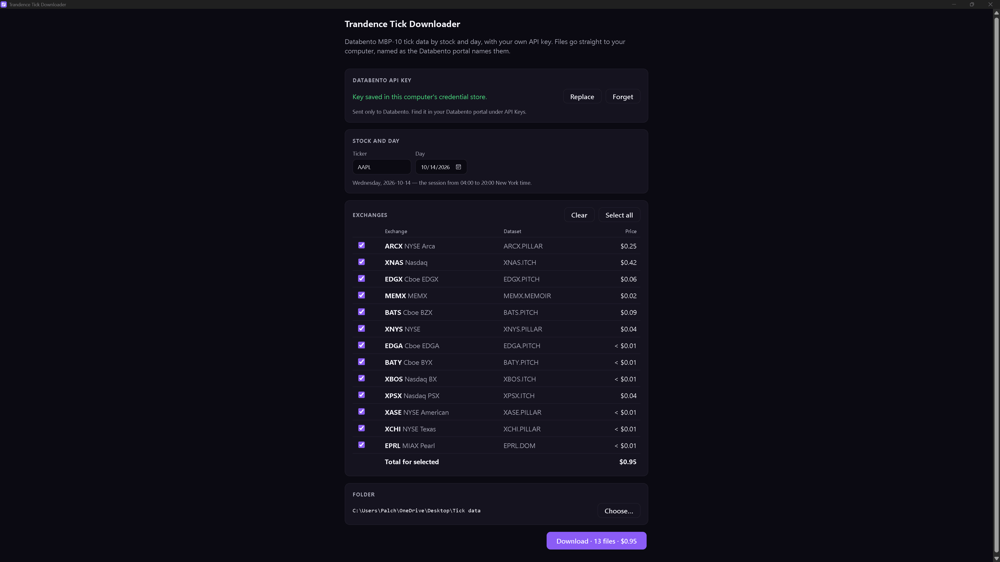

# Trandence Tick Downloader

Download Databento MBP-10 tick data — the full 10-level order book and every
trade — for a US stock and a day, with your own Databento API key. You see the
price of each exchange before you buy, choose which ones you want, and the files
go straight to a folder on your computer.

The files are the ones the Databento portal would give you, with the same
names (`xnas-itch-20260926.mbp-10.csv.zst`), so they import into
[Trandence — Free Trading Journal & Level 2 Market Replay](https://trandence.com) as they are, and work with any
other tool that reads Databento data.



Unofficial — not affiliated with Databento.

## How to Install

- **Windows:** get it from the
  [Microsoft Store](https://apps.microsoft.com/detail/9N90Z0Z6NTGH) — signed by
  Microsoft, installs with no warning and updates itself.
- **macOS:** download the `.dmg` from the [latest release](../../releases/latest).
  It is not code-signed yet: the first time, right-click the app in
  Applications, choose *Open*, then *Open* again.

The [releases](../../releases/latest) also carry Windows installers (`.msi`,
`-setup.exe`) for those who cannot use the Store. They are not code-signed:
Windows shows "Windows protected your PC" — click *More info*, then *Run anyway*.
The `.msix` there is the Store package, unsigned, and is not meant to be
installed directly.

## How to Download Databento MBP-10 Tick Data

1. **API key.** Paste your Databento API key (`Portal → API Keys`) and save it. It is kept securely in your system's credential store (`Windows Credential Manager` or `macOS Keychain`) and sent only to Databento. *(Need a key? Follow the [Getting Market Data from Databento guide](https://trandence.com/help/features/market-replay/getting-data-from-databento/).)*
2. **Stock and day.** Enter a US stock ticker and one trading day — a replay session covers one day.
3. **Exchanges.** Review all 13 US exchanges with full depth of book, each priced by Databento for your stock and day. All are selected at first; untick the ones you do not want — the app remembers your choice.
4. **Folder.** Choose where the files go; the app remembers it.
5. **Download.** The button shows how many files will be downloaded and their exact cost. Anything missing is highlighted when you press it. Each file shows its status and size as it arrives; files already in the folder are skipped, so nothing is bought twice.

Each file covers the full trading day's session, `04:00–20:00` New York time. Days the market was closed have no data and are left out.

## How to Replay Level 2 Order Book & Time and Sales for Free

Once your `.mbp-10.csv.zst` files are saved locally, you can replay the session tick-by-tick in **[Trandence Market Replay](https://trandence.com)** on Windows or macOS with zero conversion and no subscription fees:

1. **Open Market Replay.** Launch the [Trandence web app](https://trandence.com) in your browser (or install via the [Microsoft Store](https://apps.microsoft.com/detail/9P9RSX099QW2) on Windows) and navigate to **Market Replay**.
2. **Load your local files.** Select or drag and drop the downloaded `.mbp-10.csv.zst` files for your chosen ticker and trading day. The files are processed directly in your browser without uploading to external servers.
3. **Replay & analyze.** Watch the full 10-level Order Book (Level 2), Time & Sales tape, and intraday charts move in sync. Adjust playback speed, jump to specific timestamps, or review your executed trades on the tape.


For full details on player controls, exchange coverage, and browser storage, see the **[Market Replay Documentation](https://trandence.com/help/features/market-replay/)**.

## What it costs

You pay Databento directly, at their usage-based prices; the app shows the
price before you download. For a typical mid-cap stock one exchange-day is a
few cents.

## Privacy

The app collects no data and has no telemetry, analytics or crash reporting.

- **Your Databento API key** is kept in your system's credential store (Windows
  Credential Manager or macOS Keychain). It is sent only to Databento
  (`hist.databento.com`), with the requests the app makes on your behalf.
- **Your choices** — the folder and the exchanges — are stored on your computer only.
- **Your requests and files** go between your computer and Databento only.
  Trandence and the authors of this app never receive your key, your requests,
  your files or any information about you.

Databento's own handling of your account and requests is governed by
Databento's privacy policy and terms, not by this app.

## Disclaimer

This app is provided **"as is", without warranty of any kind**, as set out in the
[MIT License](LICENSE). By using it you accept that:

- **You use it at your own risk.** The authors and Trandence are not liable for
  any loss or damage arising from its use or inability to use it — including
  charges, incomplete or incorrect data, lost files, or decisions made with the
  data.
- **Databento charges you, not us.** Purchases are made with your own Databento
  account and API key, at Databento's prices. The prices shown come from
  Databento and may differ from what you are finally charged. Check your
  Databento account; all billing questions and refunds are between you and
  Databento.
- **You are responsible for complying with Databento's terms** and with the
  licences of the exchanges whose data you download, including any limits on
  use, storage, redistribution or display of that data.
- **Nothing here is financial or investment advice.** The app only downloads
  data; what you do with it is your decision and your responsibility.
- **It is unofficial.** The app is not affiliated with, endorsed by or
  supported by Databento or any exchange. Databento and exchange names are
  trademarks of their respective owners and are used only to describe what the
  app connects to.

## Build from source

Needs Node.js 24 and Rust (with the MSVC build tools on Windows).

```bash
npm install
npm run tauri dev      # run
npm run tauri build    # installer in src-tauri/target/release/bundle
cargo test --manifest-path src-tauri/Cargo.toml
```

Releases are built by GitHub Actions when a `v*` tag is pushed.

## License

[MIT](LICENSE) — free to use, modify and distribute, with no warranty.
